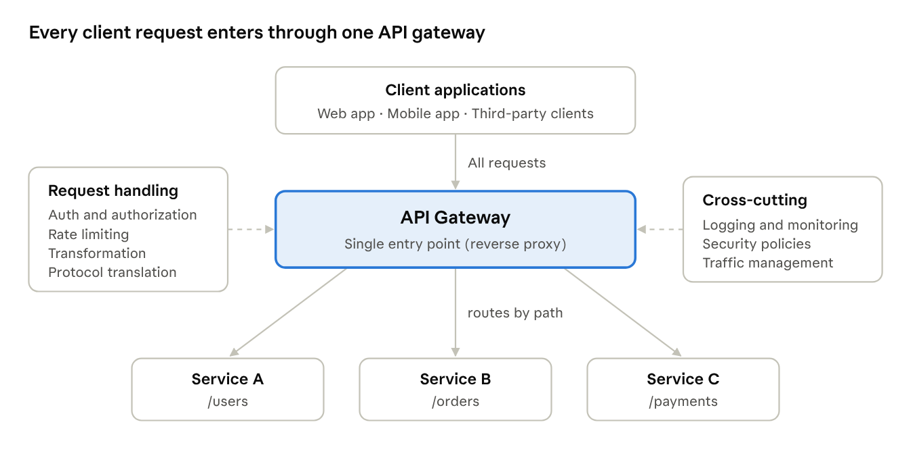
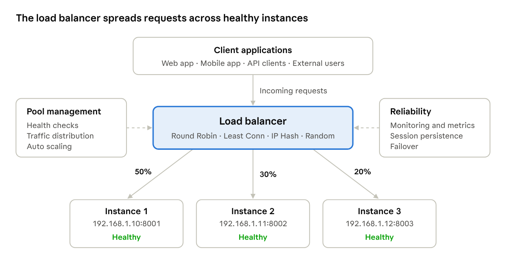
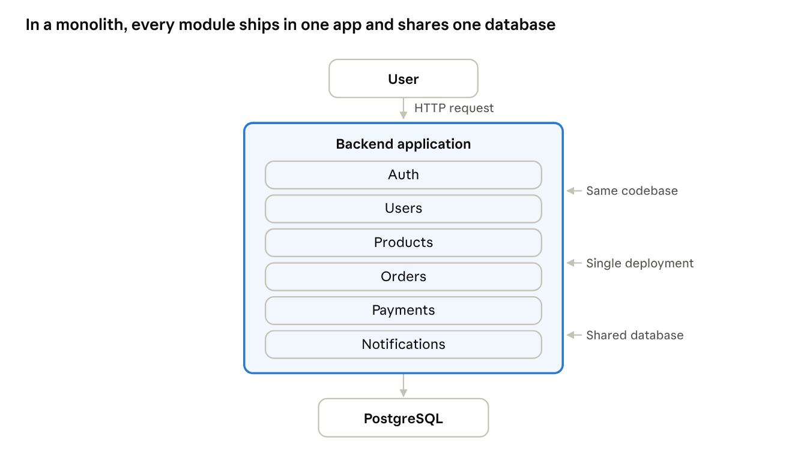
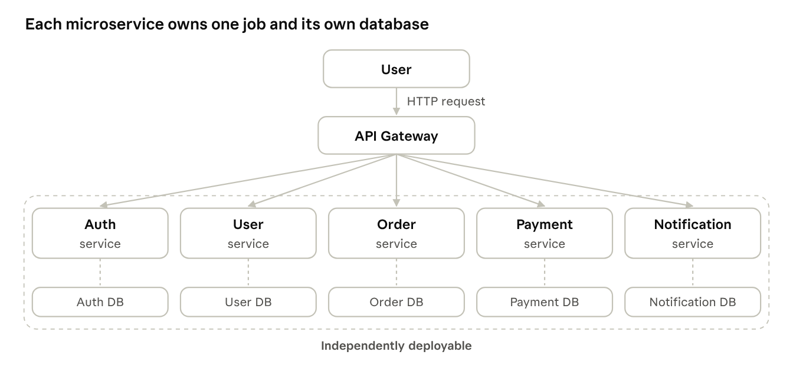
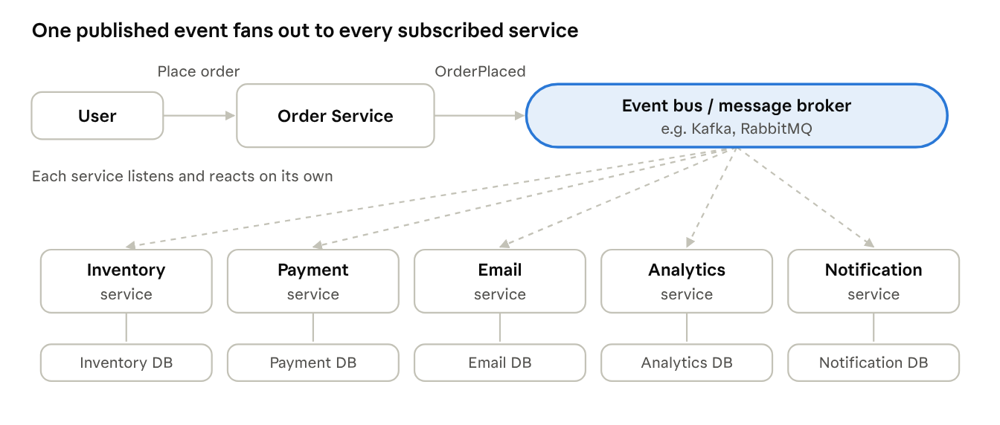
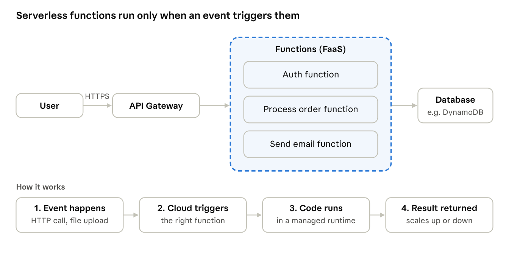
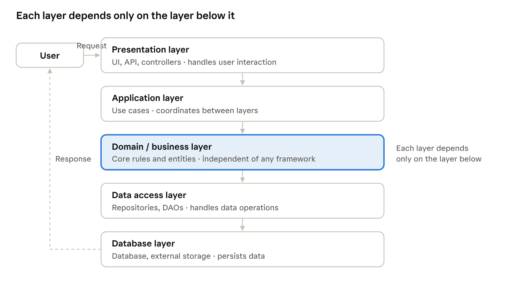
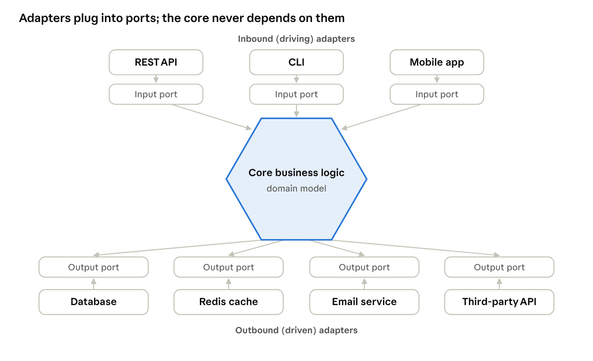
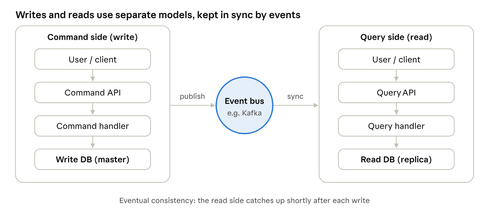

# System Architecture

## API Gateway

An API Gateway is the **single entry point** for every client request in a microservices architecture. It works as a reverse proxy: clients don't call each service directly; they call the gateway, and the gateway routes each request to the right backend service.

Clients never call services directly: the gateway checks, shapes and routes every request.

### Key responsibilities

| Responsibility | What it does |
| --- | --- |
| **Request routing** | Sends each request to the correct microservice based on URL path, HTTP method or other criteria |
| **Authentication & authorization** | Validates user credentials and permissions |
| **Rate limiting** | Caps the number of requests to prevent abuse |
| **Request/response transformation** | Modifies requests or responses as needed (e.g., adds headers, reformats data) |
| **Protocol translation** | Converts between protocols such as REST, gRPC and WebSocket |
| **Load balancing** | Spreads requests across multiple instances of a service |

The gateway also handles **logging & monitoring**, **security policies** and **traffic management** for all services in one place.

### Benefits

- Centralized security and logging
- Simpler client integration (one endpoint to call)
- Service location transparency: clients don't need to know where services live
- Fewer network calls through API composition
- Consistent policies across all services
- Easier monitoring and analytics
- Hides the internal service structure from clients
- Handles cross-cutting concerns in one place

> 💡 **Remember:** One front door for many services.

## Load Balancing

Load balancing **distributes incoming requests across multiple instances** of a service so no single instance becomes a bottleneck. It improves performance, availability and scalability by sharing the workload.

The 50 / 30 / 20 split is an example of weighted distribution; health checks keep traffic on healthy instances only.

### Common load balancing algorithms

| Algorithm | How it works | Best use case |
| --- | --- | --- |
| **Round Robin** | Sends requests to each instance in turn, equally | All instances have similar capacity |
| **Least Connections** | Sends the request to the instance with the fewest active connections | Request processing time varies |
| **IP Hash** | Routes requests from the same IP to the same instance (session persistence) | A user's session must stick to one instance |
| **Weighted Round Robin** | Distributes by configured weights; more powerful servers get more traffic | Instances have different capacity |
| **Random** | Picks an instance at random | Simple cases, or all instances are similar |

### What a load balancer also handles

| Feature | What it does |
| --- | --- |
| **Health checks** | Detects and removes unhealthy instances |
| **Failover** | Routes traffic only to healthy instances |
| **Auto scaling** | Adds or removes instances as load changes |
| **Session persistence** | Keeps a user on the same instance when required (e.g., IP Hash) |
| **Monitoring & metrics** | Tracks latency, error rate and QPS (queries per second) |

### Benefits and challenges

| ✅ Benefits | ⚠️ Challenges |
| --- | --- |
| Higher availability | Choosing the right algorithm |
| Better resource utilization | Handling session persistence (if required) |
| Horizontal scalability | Detecting and removing unhealthy instances |
| No single point of failure | Managing load across regions (global setups) |
| Handles traffic spikes efficiently | Adds complexity to the architecture |

> 💡 **Remember:** Many servers, shared work, no bottleneck.

## Architecture Patterns

There is no perfect architecture: pick the one that fits your problem, team and scale. Start with the simplest option and evolve only when the problem demands it.

### 1. Monolithic architecture

**Everything runs inside one application.** All backend modules (auth, users, products, orders, payments, notifications) live in one codebase, are deployed together as a single backend and share one database (e.g., PostgreSQL).

| ✅ Why developers like it | ⚠️ But… |
| --- | --- |
| Easy to build and debug | As it grows, every feature shares the same codebase |
| Simple deployment | A tiny change means redeploying the whole application |
| Great for MVPs and startups | All modules depend on the same code and database |

**Examples:** traditional Laravel apps, Spring Boot applications, Django projects, a single-project Express.js backend.

> 💡 **Remember:** One codebase, one deployment, one database.

### 2. Microservices architecture

**Break one big application into small, independent services.** Each service has one responsibility, runs in its own process, owns its own database, and can be developed, deployed and scaled independently. Clients usually reach the services through an [API Gateway](#api-gateway); services talk to each other through APIs or events (REST, gRPC, Kafka).

| ✅ Why developers like it | ⚠️ But… |
| --- | --- |
| Independent deployment | More complex to manage |
| Scale only the services that need it | Services must communicate over the network |
| Each service can use its own tech stack | Requires DevOps maturity |
| Fault isolation: one failure doesn't take down everything | Harder debugging across services |
| Suits large, growing systems |  |

**Examples:** Netflix, Uber, Amazon, Swiggy, large SaaS products.

**Think of it like a city:** different departments (services) work in their own buildings but cooperate to serve citizens.

> 💡 **Remember:** Small services, own data, deployed independently.

### 3. Event-driven architecture

**Components communicate by publishing and reacting to events** instead of calling each other directly. A producer publishes an event to an **event bus / message broker** (e.g., Kafka, RabbitMQ), and every service that subscribes to it reacts asynchronously. The result: loose coupling and high scalability.

**How it works:** a user places an order → the Order Service publishes `OrderPlaced` → the inventory, payment, email, analytics and notification services each react on their own (each with its own database).

**Common events:** `UserRegistered`, `OrderPlaced`, `PaymentSucceeded`, `EmailSent`, `InventoryUpdated`.

| ✅ Why developers like it | ⚠️ But… |
| --- | --- |
| Loose coupling | Harder to debug |
| Scalable and resilient | Async flow makes issues tricky to trace |
| Easy to add features (just add a subscriber) | Needs a well-configured event broker |
| Handles high traffic spikes |  |
| Great for real-time systems |  |

**Real-world use cases:** e-commerce order flows, real-time notifications, IoT data processing, audit logging, analytics pipelines.

**Think of it like a news channel:** one story is broadcast, and everyone who subscribes gets the update.

> 💡 **Remember:** Publish once, many react.

### 4. Serverless architecture

**You write the code; the cloud runs it only when needed.** Code is deployed as functions (Functions as a Service, FaaS, e.g., AWS Lambda). There are no servers to provision, each function runs only when triggered, you pay only for execution time, and the cloud handles scaling, patching and monitoring.

**How it works:** an event happens (HTTP request, file upload) → the cloud triggers the right function → your code runs in a managed environment → the result is returned and resources scale up or down automatically. A typical setup: user → API Gateway → functions (auth, process order, send email) → DynamoDB or another database.

**Common triggers:** HTTP requests (API Gateway), file uploads (S3), database changes (DynamoDB Streams), scheduled events (CloudWatch), message queues (SQS, SNS).

| ✅ Why developers like it | ⚠️ But… |
| --- | --- |
| No server management | Cold starts can add latency |
| Auto scaling out of the box | Execution time limits apply |
| Pay-per-use (cost efficient) | Not ideal for long-running processes |
| High availability | Vendor lock-in risk |
| Focus on business logic, not infrastructure |  |

**Use cases:** REST APIs and backends, image/video processing, real-time file processing, chatbots and webhooks, automation and cron jobs.

**Think of it like a taxi:** instead of owning a car (server) that runs 24/7, you call a taxi (function) only when you need a ride and pay for that trip.

> 💡 **Remember:** No servers to manage; pay only when your code runs.

### 5. Layered architecture (N-tier)

**Organize code into layers, each with a single responsibility.** Each layer has a well-defined role and talks only to the layer next to it (it depends only on the layer below). This keeps code clean, maintainable and testable.

**Typical flow:** request from user → presentation layer (API) → business logic → data access layer → saved in the database → response returns back up to the user.

| ✅ Why developers like it | ⚠️ But… |
| --- | --- |
| Separation of concerns | More layers can mean more boilerplate |
| Easy to maintain and test | Over-engineering risk for small projects |
| Layers can be reused | Some performance overhead |
| Scales well for complex applications |  |

**Examples:** Java Spring Boot (Controller → Service → Repository), .NET Core applications, enterprise apps, most traditional monoliths.

**Think of it like a restaurant:** customer (presentation) → waiter (application) → chef (business logic) → kitchen staff (data access) → storage (database).

> 💡 **Remember:** Each layer does one job and only talks to its neighbour.

### 6. Hexagonal architecture (ports & adapters)

**Keep the core independent of external details.** The core business logic (domain model) sits in the centre; everything outside is a plug-in connected through **ports** (interfaces) and **adapters** (implementations). You can change databases, frameworks or APIs without touching the core.

**Real-world example:** switching from MySQL to PostgreSQL should not affect the core logic; only the database adapter changes.

**Layered vs hexagonal:** in a layered app, dependencies flow down toward the database; in hexagonal, every dependency points inward to the core.

| ✅ Why developers like it | ⚠️ But… |
| --- | --- |
| Framework independent | More upfront structure |
| Highly testable | Slightly more code |
| Easy to swap components | Overkill for tiny projects |
| Low coupling, high cohesion |  |
| Built for long-term maintainability |  |

**Typical use cases:** enterprise applications, complex domain rules, systems with many adapters (databases, messaging, APIs), projects built for the long term.

**Think of it like a laptop power adapter:** the laptop (core) stays the same; you plug in a different charger (adapter) in each country.

> 💡 **Remember:** Core in the middle, everything else is a plug-in.

### 7. CQRS (Command Query Responsibility Segregation)

**Separate models for writing and reading.** The system is split into a **command side** that handles writes (create, update, delete) and a **query side** that handles reads (GET, search, reports). They use different models and often different databases, which improves scalability, performance and flexibility.

**How it works:** the user makes a change (command) → the command handler validates it and updates the write DB → an event is published to the event bus (see [Event-driven architecture](#3-event-driven-architecture)) → the read model updates the read DB → queries are served from the read DB.

**Real-world example:** in e-commerce, placing an order is a command; inventory updates and events are published; the read model builds reports, dashboards and order history, so users query quickly without slowing down writes.

| ✅ Why developers like it | ⚠️ But… |
| --- | --- |
| High performance for reads and writes | More components to manage |
| Independent scaling of each side | Eventual consistency between write and read models |
| Easier to optimize queries | More operational complexity |
| Flexible data models |  |
| Great for complex domains and analytics |  |

**Typical use cases:** high-read systems, analytics and reporting, financial systems, event sourcing, large SaaS platforms.

**Think of it like a restaurant with two kitchens:** one cooks the orders (writes), the other plates food for customers (reads), so serving stays fast without slowing the cooking.

> 💡 **Remember:** One model to write, one to read, kept in sync by events.

### Choosing an architecture

| Scenario | Best fit | Why it fits |
| --- | --- | --- |
| MVP, small project, early-stage startup | **Monolithic** | Fastest to build, easy to deploy and maintain; good while requirements are still changing |
| Growing app, clear modules, medium complexity | **Layered (N-tier)** | Separation of concerns, easy to maintain and test, solid foundation for scale |
| Large scale, independent teams, high availability | **Microservices** | Independent services, scale only what you need, teams move fast |
| Real-time features, notifications, IoT, event-heavy apps | **Event-driven** | Loose coupling through events; real-time, async and scalable |
| Short-lived tasks, APIs, automation, cost optimization | **Serverless** | No server management, pay only for what runs, automatic scaling |
| Complex domain, long-term product, high maintainability | **Hexagonal** | Isolated core; easy to swap frameworks, databases or external services |
| High read load, analytics, reporting, audit-heavy apps | **CQRS** | Separately optimized write and read models for better performance and scalability |

**What really matters when choosing:** team skills, project complexity, scalability needs, budget and time to market.

> 💡 **Golden rule:** Start simple. Measure. Evolve only when the problem demands it.

---

[← Back to contents](README.md)
