# LLMs & Generative AI

## RAG & AI Engineering

RAG lets an LLM look up your own data before it answers. The 15 topics below follow the pipeline in order: prepare the data, retrieve, generate, improve retrieval, then evaluate and extend.

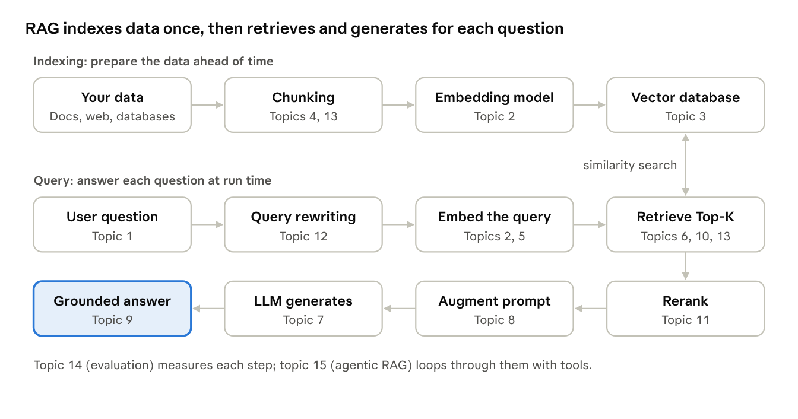

Use the topic numbers on each box to jump to its notes below.

### 1. What is RAG?

**Retrieval-Augmented Generation (RAG)** lets an LLM search your data before it answers. It first retrieves relevant information from external sources (documents, databases, the web), then uses it to generate a more accurate, grounded answer.

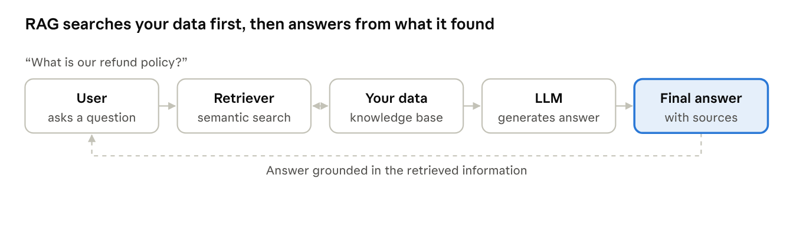

**In simple words:** search your data → give it to the LLM → generate the answer.

**Why we need it**

- LLMs don't know your private or latest data (company docs, internal policies).
- Training data goes out of date; there are no real-time updates.
- LLMs can hallucinate: give confident but wrong answers.
- RAG lets the model answer from your real, trusted information.

| Aspect | Plain LLM (model only) | RAG (model + your data) |
| --- | --- | --- |
| Knowledge | Training data only | Training data + external data |
| Private data | ❌ No access | ✅ Can use your data |
| Freshness | ❌ May be outdated | ✅ Up to date |
| Accuracy | Sometimes generic or wrong | More accurate and contextual |
| Example question | "What is RAG?" | "What is our refund policy?" |

**Where the data comes from:** documents (PDFs, Word files, manuals), web pages (company site, help center), databases (product, customer data), internal tools (Notion, Confluence, Slack) and knowledge bases (policies, SOPs, guides).

| ✅ Benefits | ⚠️ Limitations |
| --- | --- |
| More accurate, reliable answers | Answer quality depends on retrieval quality |
| Uses your own private data | Needs good data preparation (chunking, cleaning, metadata) |
| Works with the latest information | Adds infrastructure (vector DB, retriever) |
| Fewer hallucinations | Slower and costlier than a plain LLM |
| Better for domain-specific use (HR, legal, healthcare) |  |

> 💡 **Remember:** RAG = Retrieve + Augment + Generate.

### 2. Embeddings

**Embeddings** turn data (text, images, audio) into **vectors**: lists of numbers that capture meaning, not just exact words. Similar meanings get similar vectors, which sit closer together in vector space. Think of an embedding as a coordinate for meaning.

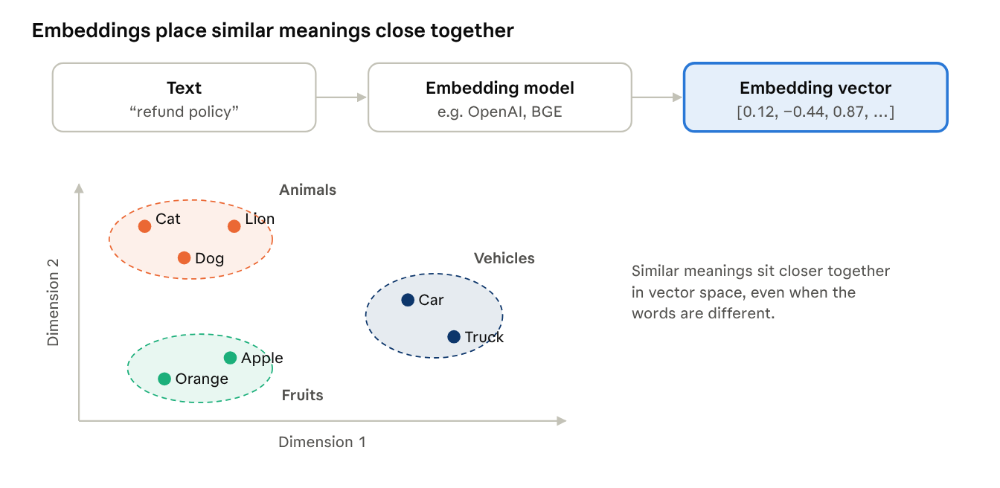

**Measuring similarity: cosine similarity** compares the angle between two vectors.

```latex
\cos(\theta) = \frac{A \cdot B}{\|A\| \, \|B\|}
```

A · B is the dot product, ‖A‖ is a vector's magnitude. The value runs from −1 to 1 (usually 0 to 1 for text): 1 = same meaning, 0 = unrelated, −1 = opposite (rare).

| Text A | Text B | Cosine similarity | Meaning |
| --- | --- | --- | --- |
| "refund policy" | "money back rules" | 0.92 | ✅ Very similar |
| "cancel order" | "order cancellation" | 0.89 | ✅ Very similar |
| "laptop" | "notebook" | 0.86 | ✅ Similar |
| "refund policy" | "weather today" | 0.08 | ❌ Not similar |

**Where they're used:** semantic search, RAG, recommendations, classification (topic, intent), clustering and multimodal search (text + image + audio).

**Common misconceptions**

- ❌ They're just word counts.
- ❌ They store the exact text (they don't).
- ❌ They only work for text (they also work for images, audio, etc.).
- ❌ More dimensions always means better (not necessarily).

> 💡 **Remember:** Embeddings turn meaning into numbers.

### 3. Vector databases

A **vector database** stores embeddings and quickly finds the most similar ones (nearest-neighbour search). It is built for meaning-based search, not exact keyword matching. Think of it as searchable memory for the meaning of your data.

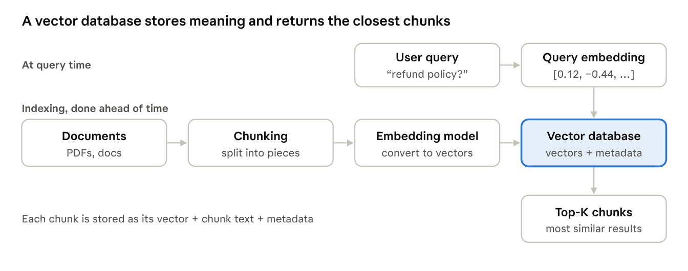

| Aspect | Traditional DB (SQL) | Vector DB |
| --- | --- | --- |
| Search type | Exact match, filters (e.g., user\_id = 101) | Similarity (meaning-based) |
| Data stored | Text, numbers, tables | Vectors + metadata |
| Best for | Transactions, structured data | Semantic search, RAG, AI apps |

**What each record stores** (together they make retrieval powerful):

| Item | Example |
| --- | --- |
| Embedding (vector) | \[0.12, −0.44, 0.87, …\] |
| Chunk text | "Our refund policy allows …" |
| Metadata | {source: "HR\_Policy.pdf", page: 12, category: "HR"} |

| Popular vector DB | Known for |
| --- | --- |
| **FAISS** | Open source, fast, good for prototyping |
| **Pinecone** | Managed, scalable, production-ready |
| **Weaviate** | Feature-rich, supports hybrid search |
| **Chroma** | Simple, developer-friendly |
| **Milvus** | High performance at large scale |

**Benefits:** fast similarity search on large data, works with unstructured data (PDFs, docs), supports metadata filters, plugs easily into LLM pipelines.

**Keep in mind:** it doesn't create embeddings (you still need an embedding model), and search quality depends on your chunking and embeddings.

> 💡 **Remember:** It stores meaning, not just text.

### 4. Chunking documents

**Chunking** splits a large document into smaller, coherent pieces (chunks). Each chunk is then embedded and stored in the vector database for retrieval.

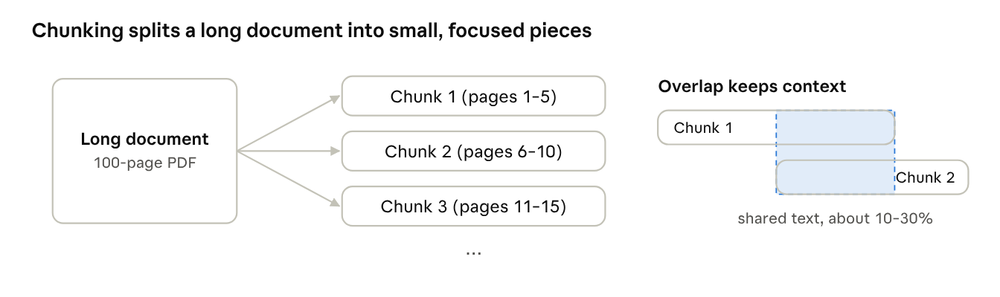

**Why it matters**

- Whole documents are too large to retrieve as one unit.
- Smaller chunks are more focused and relevant.
- Retrieved context has to fit in the LLM's context window (topic 7).
- Less noise means better answers.

| Strategy | How it works | When to use |
| --- | --- | --- |
| **Fixed-size** | Split by a fixed number of tokens or characters | Simple and fast; general use |
| **Overlap** | Neighbouring chunks share some text (about 10–30%) | Keep context across chunk boundaries |
| **Sentence / paragraph** | Split at natural sentence or paragraph breaks | Well-structured text (articles, docs) |
| **Semantic** | Split by meaning (topic, section) | Long, complex documents |
| **Recursive** | Try large chunks first, split further only if needed | Keep structure (headings, sections) |

| Chunk size (approx.) | Pros | Cons | When to use |
| --- | --- | --- | --- |
| Small (100–300 tokens) | Focused, precise retrieval | May miss broader context | FAQs, short docs, Q&A |
| Medium (300–800 tokens) | Good balance of relevance and context | Slightly more noise | Most use cases |
| Large (800–1,500 tokens) | More context, fewer chunks | Less precise, can be noisy | Long-form docs (research, manuals) |

**Good vs bad chunk:** a bad chunk crams a whole leave policy (annual, sick, maternity, approvals, exceptions) into one piece, so it is too broad and hard to retrieve. A good chunk covers one clear topic, such as maternity leave eligibility, so it is relevant and easy to retrieve.

**Best practices:** keep chunks semantically complete (a full idea, not a random cut), use a small overlap, preserve structure (headings, lists, tables) and add metadata (source, page, section, date).

> 💡 **Remember:** Good chunks → good embeddings → good RAG.

### 5. Semantic search

**Semantic search** finds results by meaning and intent, using embeddings, instead of matching exact words. Word match becomes meaning match.

| Aspect | Keyword search (lexical) | Semantic search (meaning-based) |
| --- | --- | --- |
| How it works | Matches exact words | Matches meaning via vectors |
| Example query | "refund policy" | "get my money back" |
| Handles synonyms? | ❌ No | ✅ Yes |
| Weakness | Misses documents worded differently | May return related but not exact results |
| Best for | Exact terms (IDs, names, codes) | Natural-language questions, RAG |

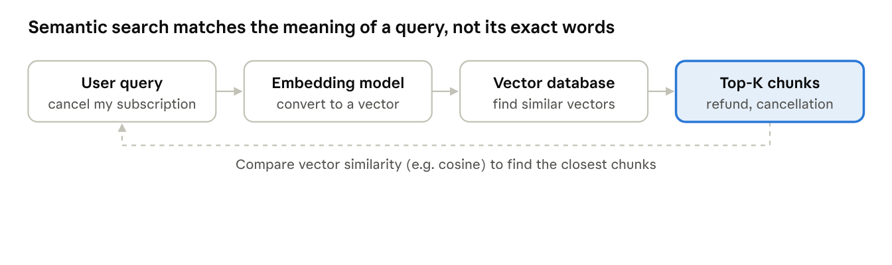

**Example:** for "How can I get a refund?", keyword search ranks *Payment terms* and *Order tracking* above *Refund policy*. Semantic search returns *Refund & returns policy*, *Cancellation and refund* and *Money-back guidelines*.

**Where it's used:** RAG, enterprise and knowledge search, customer support, recommendations, auto-tagging and document organization.

**Limitations:** can return conceptually similar but not exact results, depends heavily on the embedding model, and is slower and costlier than simple keyword search.

> 💡 **Remember:** Search by meaning, not by keywords.

### 6. Retriever & Top-K

The **retriever** searches the vector database and fetches the most relevant chunks for a query, using embeddings and a similarity measure. **Top-K** is how many of the highest-scoring chunks get passed on (e.g., 3, 5 or 10). The retriever finds; Top-K decides how many to use.

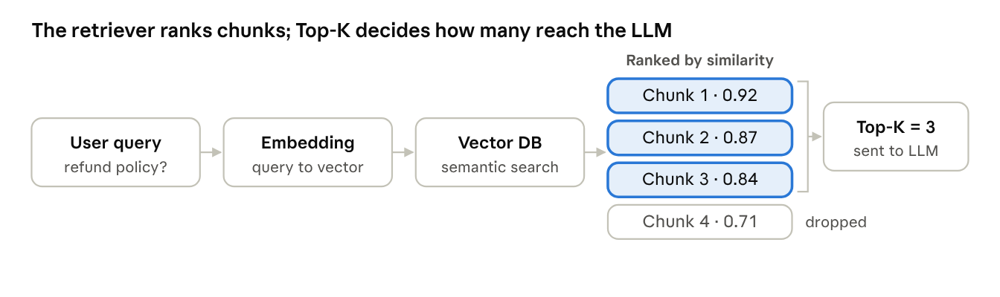

**Choosing K** is a trade-off between **precision** (how relevant the results are) and **recall** (how much useful information you cover).

| K value | Behaviour | When to use |
| --- | --- | --- |
| K = 1–3 | More precise, less noise | Simple, focused queries |
| K = 4–8 | Balanced (most common) | General RAG, Q&A |
| K = 10+ | Higher recall, more context, can be noisy | Complex or multi-step questions |

**Common pitfalls:** K too small (misses important context), K too large (adds noisy text), and not checking retrieval quality (similarity scores).

> 💡 **Remember:** The retriever finds; Top-K picks how many.

### 7. Context window

The **context window** is the total number of tokens an LLM can process in one request: the model's short-term working memory, large but fixed in size. Once the limit is reached, extra text is truncated (ignored).

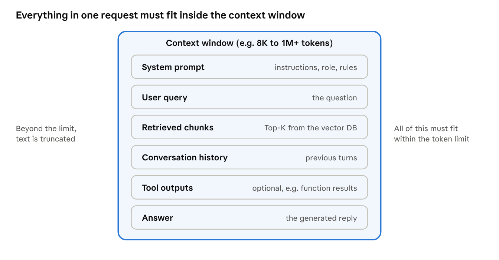

**Tokens, the unit of context**

- LLMs count tokens, not characters or words.
- A token can be a word, part of a word or a symbol.
- Rule of thumb: 1 token ≈ 4 characters ≈ 0.75 words, so a 100-word paragraph is about 130 tokens.

Window sizes differ a lot between models (from about 8K to 1M+ tokens) and change with each release, so check the current model's documentation for exact numbers.

|  | Larger context window | Smaller context window |
| --- | --- | --- |
| ✅ Strengths | More context (more chunks, long documents); handles complex, multi-step tasks | Faster and cheaper; fine for simple, focused queries |
| ❌ Weaknesses | Higher cost and latency | Limited context; may miss important information |

**Using it well:** retrieve only the most relevant chunks (the right Top-K), keep prompts concise, summarize or compress long content, and remove redundant information.

> 💡 **Remember:** A bigger window helps, but relevance matters more than volume.

### 8. Prompt augmentation

**Prompt augmentation** means adding the retrieved chunks into the final prompt sent to the LLM. It bridges retrieval and generation: the LLM only uses what it sees in the prompt, so retrieval alone is not enough.

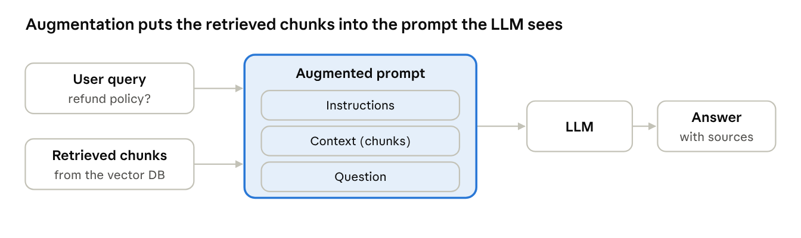

**Example prompt (simplified)**

```
You are a helpful assistant. Use the context below to answer the question.
If the answer is not in the context, say you don't know.

Context: {retrieved chunks}
Question: {user question}
Answer:
```

**A good augmented prompt has:** clear, simple instructions; well-labelled sections (context, question, answer); only relevant chunks; a request for citations or sources when needed; a rule for missing information ("say you don't know"); and a specific output format.

**Common failure cases:** too much irrelevant context, weak or unclear instructions, conflicting information across chunks, no output format (vague answers), and raw documents passed in without structure. Even with good retrieval, a weak prompt can produce a poor answer.

**Real-world example:** asked about the return policy for electronics, the system retrieves three chunks (general returns, electronics, exchanges), builds the prompt and answers "Electronics can be returned within 7 days if unopened", citing the electronics chunk as its source.

> 💡 **Remember:** Retrieval finds the information; augmentation gives it to the model the right way.

### 9. Grounding & hallucination

**Grounding** means generating an answer from real, retrieved evidence (documents, knowledge base, website), so the answer is tied to a source you can verify. A **hallucination** is a confident answer that is incorrect, unsupported or made up, such as an invented policy, a non-existent source, or a wrong date or number.

**Why hallucinations happen**

1. The LLM tries to be helpful even when it doesn't know the answer.
2. Retrieval returned missing or weak context.
3. The question is ambiguous or underspecified.
4. The training data is outdated.
5. The model fills gaps with plausible-sounding text.

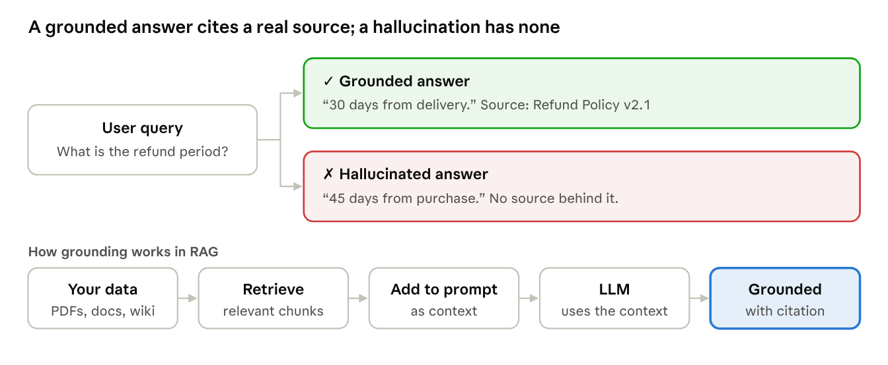

**How to reduce hallucinations**

- Use high-quality, relevant retrieval (better Top-K, reranking, metadata filters).
- Tell the model to answer only from the provided context.
- Ask it to cite sources (document, page or URL).
- Handle missing context explicitly (e.g., reply "not found").
- Evaluate answers for faithfulness and correctness (see topic 14).

> 💡 **Remember:** Good retrieval + clear prompts + citations = fewer hallucinations.

### 10. Hybrid search

**Hybrid search** combines keyword (lexical) search and semantic (vector) search, so it catches both exact terms and the meaning behind a query. This improves recall and precision, even when the user's words differ from the document's. (The keyword vs semantic comparison is in topic 5.)

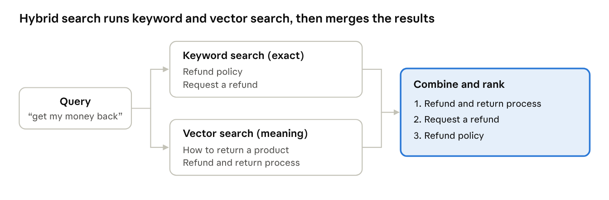

| Merge method | How it combines results |
| --- | --- |
| **Score fusion** | Combine both scores (e.g., a weighted sum) |
| **Rank fusion** | Merge and re-rank by position (e.g., Reciprocal Rank Fusion, RRF) |
| **Filter + re-rank** | Keyword search narrows the set, then semantic search re-ranks it |

| ✅ Advantages | ⚠️ Considerations |
| --- | --- |
| More relevant and complete results | Slightly higher compute and latency |
| Works for simple and complex queries | Needs score tuning (weights, thresholds) |

**Where it's useful:** RAG systems, enterprise search (docs, wikis, knowledge bases), customer support and FAQ search, and e-commerce (product search, policy queries).

> 💡 **Remember:** Hybrid = exact matches + meaning.

### 11. Reranking

**Reranking** is a post-retrieval step that re-scores the retrieved chunks with a more accurate (but costlier) model and reorders them by relevance. Think of it as a second opinion that picks the most useful results from many relevant ones.

**Why it's needed:** first-pass retrieval (e.g., vector search) is fast but not always precise, and can return relevant but less useful chunks. Reranking pushes the best ones to the top, giving the LLM cleaner context.

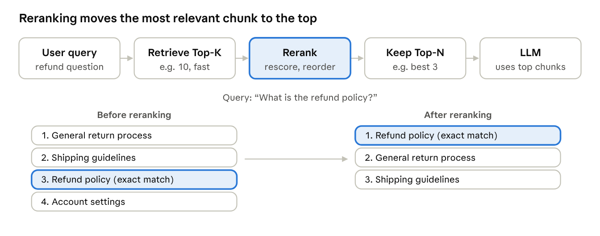

| Technique | How it works | Trade-off |
| --- | --- | --- |
| **Cross-encoder** | Reads the query and chunk together and scores their relevance directly | Most accurate, but slower and costlier |
| **Bi-encoder + reranker** | A fast bi-encoder retriever gets Top-K, then a stronger reranker (cross-encoder or LLM) reorders them | Practical and scalable |

| Aspect | Retrieval (e.g., vector search) | Reranking |
| --- | --- | --- |
| Goal | Find a broad set of relevant chunks (Top-K) | Reorder those chunks by deeper relevance |
| Speed | Fast | Slower |
| Accuracy | Good (approximate) | Higher (more precise) |
| Cost | Lower | Higher (more compute) |

**Most useful when:** retrieved results are similar or ambiguous, answers are domain-specific or business-critical (policies, legal, finance), or answer quality matters in production RAG.

> 💡 **Remember:** Retrieve broad, rerank precise.

### 12. Query rewriting

**Query rewriting** turns the user's question into a clearer, richer, more search-friendly version (usually with an LLM) while keeping the original intent. Same question, better wording, better results.

**Why it matters:** users often ask short, vague or incomplete questions, while retrieval works best with clear, context-rich queries. Rewriting adds missing context, keywords or alternative phrasing, which raises recall and accuracy.

| Original query | Rewritten query |
| --- | --- |
| "refund?" | "What is the refund policy and eligibility criteria?" |
| "late order" | "What happens if my order is delivered late?" |
| "cancel product" | "How do I cancel a product and get a refund?" |

| Strategy | What it does |
| --- | --- |
| **Clarification** | Makes the query more specific |
| **Expansion** | Adds relevant keywords and context |
| **Paraphrasing** | Rephrases with the same intent in different words |
| **Decomposition** | Breaks a complex query into smaller, focused queries |

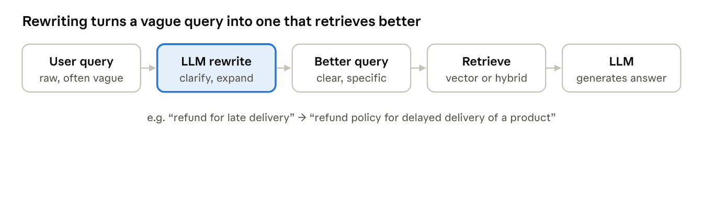

**Most useful when:** queries are ambiguous or too short, the domain uses synonyms ("invoice" vs "bill"), questions have several parts ("how do I return it and get a refund?"), or retrieval quality is low.

> 💡 **Remember:** Better question in, better chunks out.

### 13. Metadata filtering

**Metadata** is data about data that describes a document or chunk (source, type, topic, author, date, version). **Metadata filtering** narrows the search to matching documents before or alongside similarity search, e.g., only documents where topic = "Refund" and language = "English".

| Common field | Example values |
| --- | --- |
| Topic / category | Refund, Delivery, Account |
| Document type | FAQ, Policy, Guide, Blog |
| Date / updated at | 2025-11-10 |
| Language | English, Hindi |
| Source | Help Center, Internal Wiki |
| Version | v1.2, v2.0 |

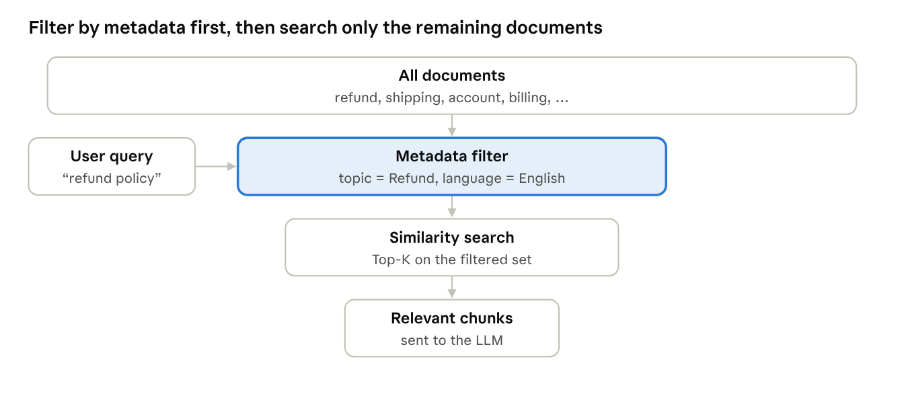

**Example:** without a filter, "refund policy" returns a mix of refund, return and shipping chunks. With topic = Refund and type = FAQ, it returns only refund chunks, so the results are more relevant and focused.

**When to use it:** large knowledge bases (thousands of docs), multi-domain systems (product, billing, support), freshness needs (latest version only), and language- or region-specific retrieval.

| ✅ Benefits | ⚠️ Trade-offs |
| --- | --- |
| Higher relevance and precision | Needs well-defined metadata |
| Faster retrieval (smaller search space) | Extra effort in data preparation |
| Better control over what is retrieved | Over-filtering can miss useful results |

> 💡 **Remember:** Filter by context, not just similarity.

### 14. RAG evaluation

**RAG evaluation** measures how well a RAG system retrieves relevant information and generates accurate, grounded answers. The goal: answers that are correct, relevant and based on the right sources.

**What we evaluate**

- **Retrieval quality:** are the retrieved chunks relevant to the query?
- **Generation quality:** is the answer accurate, complete and grounded in the retrieved context?
- **End-to-end performance:** does the whole system actually solve the user's question?

| Metric | What it measures |
| --- | --- |
| **Recall@K** | How many of all the relevant documents appear in the top-K results |
| **Precision@K** | How many of the top-K results are actually relevant |
| **Context relevance** | How useful the retrieved context is for answering the query |
| **Faithfulness (groundedness)** | Whether the answer is supported by the retrieved context, not an outside guess |
| **Answer relevance** | Whether the answer actually addresses the user's question |
| **Correctness** | Whether the information is factually accurate |
| **Completeness** | Whether the answer covers every key part of the question |
| **Citation / source** | Whether the answer gives a valid, relevant source |

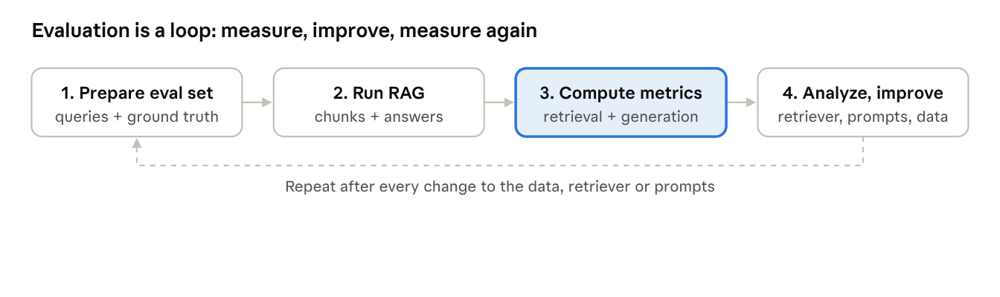

**Example report:** Recall@5 = 0.92 means 92% of relevant docs were retrieved; faithfulness = 0.94 means answers are well grounded in the context.

| Common dataset | Use case |
| --- | --- |
| **Natural Questions (NQ)** | Real-world questions from Google search |
| **TriviaQA** | Open-domain Q&A across diverse topics |
| **HotpotQA** | Multi-hop questions that need several pieces of evidence |
| **Domain-specific sets** | Your own data (company docs, product FAQs, policies) |

**Improving performance:** use high-quality, well-chunked data; tune the retriever (Top-K, hybrid search); design prompts for grounded answers; add metadata filters (date, source, topic); and evaluate continuously with a representative query set.

> 💡 **Remember:** Measure retrieval and generation separately, then the system end to end.

### 15. Agentic RAG

**Agentic RAG** adds an AI agent on top of RAG. Instead of a single retrieve-and-answer step, the agent can plan, decide, use tools, retrieve several times and take actions to complete a goal. In short: RAG answers a question; agentic RAG solves a task.

| Aspect | RAG | Agentic RAG |
| --- | --- | --- |
| Goal | Retrieve context and generate an answer | Plan, retrieve, reason and complete a task |
| Behaviour | Single-step, reactive | Multi-step, goal-driven |
| Tool use | Usually none | Search, APIs, code, databases |
| Retrieval | Once per query | Iterative (as many times as needed) |
| Use cases | FAQs, knowledge lookup | Research, analysis, reporting, real-world workflows |

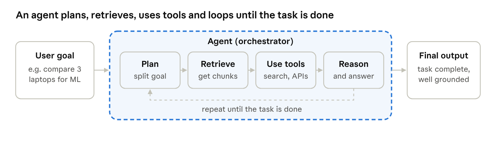

**Example:** "Find the latest laptop prices, compare 3 models and suggest the best one for ML work."

1. **Plan:** split into sub-tasks (get prices, compare specs, recommend).
2. **Retrieve:** fetch laptop specs from docs or the web.
3. **Use tools:** call a web search or API for current prices.
4. **Reason:** compare RAM, GPU, price and fit for the use case.
5. **Answer:** give a clear recommendation with the reasoning.

| Component | Role |
| --- | --- |
| **Agent (LLM)** | Plans, reasons and decides the next action |
| **Retriever** | Fetches relevant context from your data (vector or hybrid search) |
| **Tools** | External actions: web search, APIs, code execution, databases |
| **Memory (optional)** | Keeps task context and intermediate results |
| **Knowledge base** | Your domain data (docs, wikis, FAQs) |

**When to use it:** multi-step or open-ended tasks (research, compare, analyze), tasks that need external tools or data, cases where one retrieval isn't enough, and real-world assistants (research, documentation or data agents).

| ✅ Benefits | ⚠️ Challenges |
| --- | --- |
| Solves complex, real-world tasks | More complex to design and build |
| More accurate, grounded answers | Higher cost and latency |
| Can use multiple tools and data sources | Needs good tool orchestration and safety guardrails |
| Flexible and extensible | Evaluation is harder (multi-step tasks) |

> 💡 **Remember:** Agentic RAG = RAG + planning + tool use + multi-step reasoning.

---

[← Back to contents](README.md)
